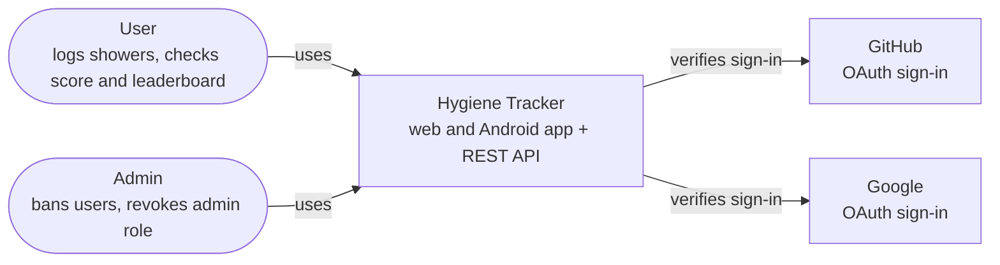
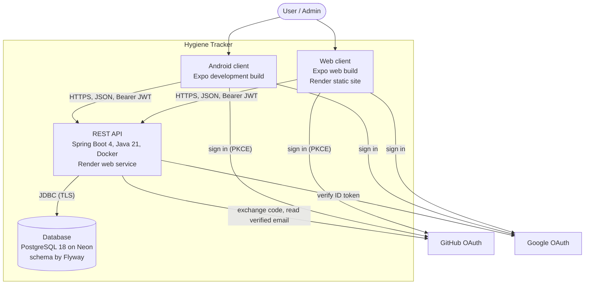
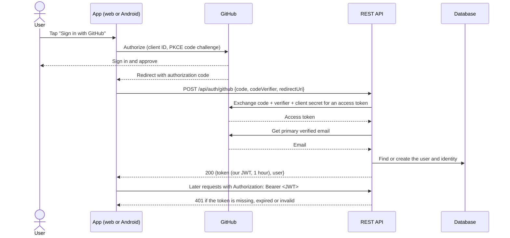

# Architecture

How Hygiene Tracker fits together, as C4 context and container diagrams, plus the sign-in
sequence. Decisions behind it are in [`docs/adr/`](adr/).

## 1. Context

Who uses the system and what it depends on.

## 2. Containers

What runs where. Everything in the dashed box is ours.

| Container | Technology | Hosted on |
|---|---|---|
| Web client | React Native with Expo, TypeScript | Render static site |
| Android client | Same codebase as the web client | Installed on the device |
| REST API | Spring Boot 4, Spring Security (OAuth2 Resource Server), Docker | Render web service |
| Database | PostgreSQL 18, Flyway migrations | Neon |

## 3. Sign-in sequence

The app signs in with the provider, and the API exchanges the result for its own JWT
([ADR-0002](adr/0002-backend-token-exchange.md)). GitHub is shown; Google is the same except the
app sends a Google ID token to `POST /api/auth/google`, which the API verifies directly.

Unverified emails get 400, and an email already registered with the other provider gets 409
([error model](error-model.md)). Saving users on sign-in (the "find or create" step) is
[#87](https://github.com/hygiene-tracker/hygiene-tracker/issues/87).
