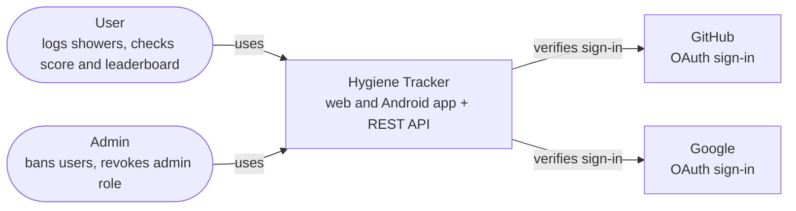
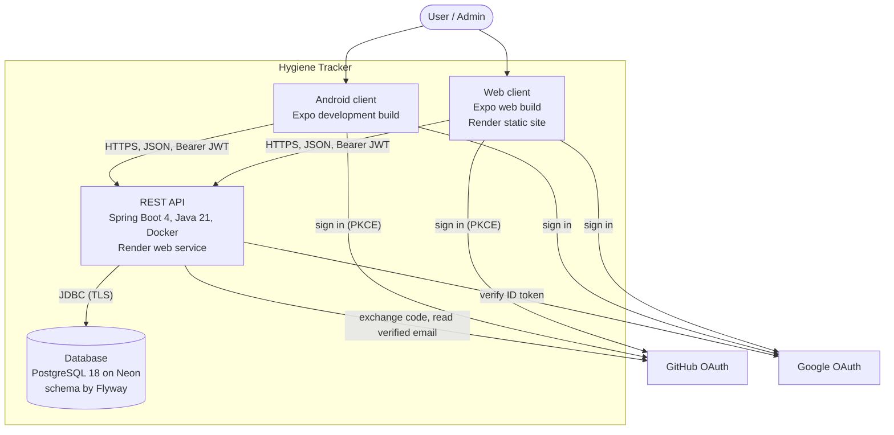
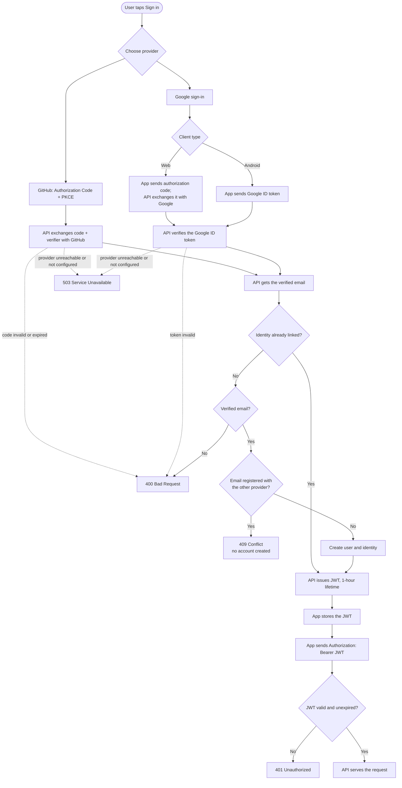

# Architecture

How Hygiene Tracker fits together, as C4 context and container diagrams, plus the sign-in
flow. Decisions behind it are in [`docs/adr/`](adr/).

## 1. Context

Who uses the system and what it depends on.

## 2. Containers

What runs where. Everything in the dashed box is ours.

| Container | Technology | Hosted on |
|---|---|---|
| Web client | React Native with Expo, TypeScript | Render static site |
| Android client | Same codebase as the web client | Installed on the device |
| REST API | Spring Boot 4, Spring Security (OAuth2 Resource Server), Docker | Render web service |
| Database | PostgreSQL 18, Flyway migrations | Neon |

## 3. Sign-in flow

How sign-in works from the button to a protected request, and where each error comes from
([error model](error-model.md)). The app signs in with GitHub or Google, and the API exchanges the
result for its own JWT ([ADR-0002](adr/0002-backend-token-exchange.md)). Which part talks to which
is in the [container diagram](#2-containers).

