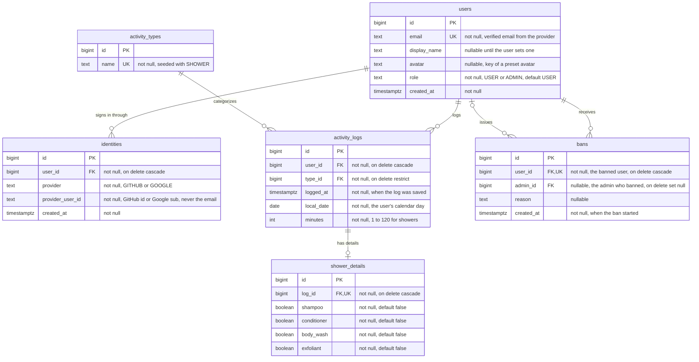

# Entity Relationship Diagram

The data model for the Hygiene Tracker API. It follows the draft ERD from the proposal
presentation and the JPA entities in #51, and adds what the [P3 guide][p3-guide] and
[Appendix I][appendix-i] require:
an email on every user, an `identities` table for GitHub and Google sign-in, and a `bans` table
for admin moderation (PRD-7).

Database migrations create these tables (see the database setup issue), the JPA entities map
to them, and the schemas in `docs/openapi.yaml` are built from them. A change to the data model
starts here, through a PR.

## Reading the diagram

| Symbol | Meaning |
|---|---|
| `\|\|` | exactly one |
| `\|o` | zero or one |
| `o{` | zero or many |
| `o\|` | zero or one (on the right-hand side) |
| `PK` / `FK` / `UK` | primary key / foreign key / unique |

## Tables

| Table | One row is | PRD |
|---|---|---|
| `users` | One account | PRD-1, PRD-2, PRD-3 |
| `identities` | One way to sign in to an account (a GitHub or a Google login) | PRD-1 |
| `activity_types` | A kind of hygiene activity. Only `SHOWER` this term (see the PRD's not-building list) | PRD-4 |
| `activity_logs` | One logged activity, such as one shower | PRD-4, PRD-5, PRD-6 |
| `shower_details` | The products used in one shower | PRD-4 |
| `bans` | One user who is currently banned, with the admin who banned them and why | PRD-7 |

## Constraints

| Table | Constraint | Why |
|---|---|---|
| `users` | `email` unique | Required email rule ([Appendix I, 3.5][appendix-email-rule]): a verified email already registered through the other provider returns 409 |
| `users` | `role` in (`USER`, `ADMIN`) | The admin role lives in the database and is enforced on the server |
| `identities` | `(provider, provider_user_id)` unique | One GitHub or Google account maps to exactly one user |
| `activity_logs` | `minutes` between 1 and 120 for showers, checked in the API | PRD-4: "Duration must be 1–120 minutes" |
| `shower_details` | `log_id` unique | A log has at most one set of shower details |
| `bans` | `user_id` unique | A user is either banned or not, so banning twice changes nothing (`PUT` is idempotent) |

## What happens on delete

| Deleted | Effect | Why |
|---|---|---|
| A user (PRD-3) | Their identities, activity logs, shower details and bans received are deleted | "Deleting removes the user's data" ([P3 guide][p3-mvp]). They can no longer sign in and leave the leaderboard |
| A user who is an admin | Bans they issued stay, with `admin_id` set to null | A ban outlives the admin who issued it |
| A ban (unbanning, PRD-7) | The row is deleted, and the user is back on the leaderboard | Unbanning ends the ban; no history is kept |
| An activity log | Its shower details are deleted | Details have no meaning without the log. (Editing or deleting a logged shower is not being built this term) |
| An activity type | Blocked while any log uses it | Types are reference data, not user data |

## Design decisions

- **The score and the streak are calculated, not stored.** They are derived from
  `activity_logs` (PRD-5 rules), so there is no column to keep in sync. Missed-day penalties
  need no background job, and the 30-day leaderboard (PRD-6) is a query over the same rows.
- **`local_date` is the user's calendar day.** "Today", streaks, missed days and the "more than
  10 showers in one day" leaderboard rule (PRD-6) all depend on which day a shower counts for.
  A UTC timestamp alone would split one evening's showers across two days for users in
  California. The client sends its local date; the API rejects a date more than one day away
  from the server's date. `logged_at` records when the log was actually saved.
- **Bans are their own table instead of a column on `users`,** as in the proposal's draft ERD.
  A row records who was banned, which admin banned them and why. Unbanning deletes the row,
  which is all PRD-7 needs (banned users disappear from the leaderboard and reappear when
  unbanned).
- **Users and identities are separate tables.** GitHub and Google identify people by their own
  IDs, never by email ([Appendix I, 3.5][appendix-email-rule]). Under the required email rule
  each user has one identity:
  signing in with the other provider's account for the same email returns 409. The table
  allows a second identity per user only if the team builds account linking (an ungraded
  stretch goal). Keeping the email on `users` is what lets the API enforce that rule.
- **IDs are `bigint` identity columns,** matching the JPA entities in #51. Ownership checks on
  every owned resource (the IDOR tests) are what stop one user from reading another's data,
  not hard-to-guess IDs.

[p3-guide]: https://github.com/CST-438-projects/cst438-docs/blob/main/projects/p3/README.md
[p3-mvp]: https://github.com/CST-438-projects/cst438-docs/blob/main/projects/p3/README.md#mvp-and-vertical-slice
[appendix-i]: https://github.com/CST-438-projects/cst438-docs/blob/main/projects/p3/appendix_i_auth.md
[appendix-email-rule]: https://github.com/CST-438-projects/cst438-docs/blob/main/projects/p3/appendix_i_auth.md#35-user-table-and-the-email-rule-linking-is-a-stretch-goal
